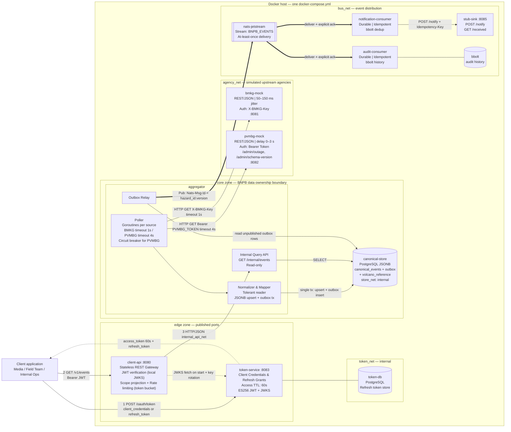

# IF4031 Milestone 1 — Architecture & Technical Contracts

**Scope of this document:** Technology selection, engineering rationale, design assumptions, system architecture diagram, and all implementation contracts.

---

## 1. Container Overview

| Container | Role | Networks |
| :--- | :--- | :--- |
| `bmkg-mock` | Simulated BMKG service. REST/JSON, low latency (50–150 ms jittered). Enforces `X-BMKG-Key`. | `agency_net` |
| `pvmbg-mock` | Simulated PVMBG service. REST/JSON, injected delay 0–3 s, adds `confidence_level`. Enforces `Authorization: Bearer <pvmbg-token>`. Supports `/admin/outage` and `/admin/schema-version`. | `agency_net` |
| `aggregator` | Polls agencies using isolated credentials, normalizes data, writes the Canonical Store, relays outbox rows to the broker, serves an internal read-only query API. | `agency_net`, `store_net`, `internal_api_net`, `bus_net` |
| `canonical-store` | PostgreSQL 16+ with JSONB. Owned exclusively by the Aggregator. | `store_net` (internal: true) |
| `nats-jetstream` | Message broker (JetStream). | `bus_net` |
| `notification-consumer` | Downstream consumer 1. Posts notifications to `stub-sink`. | `bus_net` |
| `audit-consumer` | Downstream consumer 2. Appends event history to local bbolt. | `bus_net` |
| `stub-sink` | Tiny HTTP stub service. Accepts `POST /notify`, deduplicates by `Idempotency-Key`, exposes `GET /received` for demo verification. | `bus_net` |
| `token-service` | Issues signed JWT access tokens (ES256, default TTL 60 s) and refresh tokens. Persists refresh tokens to `token-db`. Serves `/oauth/token` and JWKS endpoint. | `edge_net`, `token_net` |
| `token-db` | PostgreSQL. Stores refresh tokens. Owned exclusively by `token-service`. | `token_net` (internal: true) |
| `client-api` | Client-facing REST gateway. Verifies JWTs locally (JWKS), enforces scope-based field projection, rate-limits via token bucket, reads data through the Aggregator's internal API. | `edge_net`, `internal_api_net` |

### Network Topology

| Network | `internal` | Members |
| :--- | :--- | :--- |
| `agency_net` | false (no host ports for mocks) | `bmkg-mock`, `pvmbg-mock`, `aggregator` |
| `store_net` | **true** | `aggregator`, `canonical-store` |
| `internal_api_net` | **true** | `aggregator`, `client-api` |
| `bus_net` | **true** | `aggregator`, `nats-jetstream`, `notification-consumer`, `audit-consumer`, `stub-sink` |
| `token_net` | **true** | `token-service`, `token-db` |
| `edge_net` | false (published ports) | `token-service` `:8083`, `client-api` `:8080` |

> [!NOTE]
> Only `client-api` (`:8080`) and `token-service` (`:8083`) publish host ports. BMKG mock and PVMBG mock ports (`8081`, `8082`) are reachable from the host for demo convenience but are on `agency_net` (non-internal) — they must still validate credentials on every request.

---

## 2. Technology Stack

| Layer | Choice | Reason |
| :--- | :--- | :--- |
| **Backend language** | Go (current stable), stdlib `net/http`, `errgroup`, `pgx/v5`, `nats.go` | One toolchain for all services; goroutines natively isolate PVMBG slow I/O from BMKG fast I/O |
| **Canonical Store** | PostgreSQL 16+ with JSONB | Hybrid model: typed core columns + JSONB `attributes` — new fields (e.g., `confidence_level`) land in JSONB with no DDL |
| **Token Store** | PostgreSQL 16+ (separate `token-db`) | Strict storage-ownership rule; refresh tokens need ACID guarantees and a simple indexed lookup |
| **Message broker** | NATS 2.10+ with JetStream | At-least-once delivery, native producer dedup via `Nats-Msg-Id`, lowest compose footprint |
| **Consumer local state** | bbolt (embedded KV) on a named Docker volume | Idempotency dedup keys and audit history, isolated per consumer |
| **Token signing** | ES256 JWT + JWKS endpoint | Asymmetric signing; `client-api` verifies locally without calling `token-service` on every request |
| **Rate limiting** | `golang.org/x/time/rate` (token bucket) | Standard library extension; returns HTTP 429 with `Retry-After` |
| **Logging** | `zerolog` | Zero-alloc JSON logs; idiomatic Go |
| **Load testing** | k6 | Docker-friendly, JS scripting, p95/p99 reporting, HTML output |
| **Contracts** | `/contracts/` Go module (structs + JSON tags only) | Shared type definitions without sharing business logic |
| **Packaging** | Multi-stage Dockerfiles, distroless static images, one `docker-compose.yml` | Healthchecks with `depends_on: condition: service_healthy`; segmented networks |

---

## 3. Design Decisions

### 3.1 Canonical Store: PostgreSQL JSONB

**Schema:**

```sql
-- Volcano reference (static seed, owned by Aggregator)
CREATE TABLE volcano_reference (
  volcano_id   TEXT PRIMARY KEY,
  name         TEXT NOT NULL,
  latitude     DOUBLE PRECISION NOT NULL,
  longitude    DOUBLE PRECISION NOT NULL
);

-- Canonical events
CREATE TABLE canonical_events (
  hazard_id    TEXT PRIMARY KEY,           -- UUID generated by Aggregator on first insert
  source       TEXT NOT NULL,              -- 'BMKG' | 'PVMBG'
  source_ref_id TEXT NOT NULL,            -- original event_id / report_id
  hazard_type  TEXT NOT NULL,             -- 'SEISMIC' | 'VOLCANIC'
  severity     TEXT NOT NULL,             -- 'NORMAL' | 'WASPADA' | 'SIAGA' | 'AWAS'
  area_name    TEXT NOT NULL,
  latitude     DOUBLE PRECISION NOT NULL,
  longitude    DOUBLE PRECISION NOT NULL,
  occurred_at  TIMESTAMPTZ NOT NULL,
  ingested_at  TIMESTAMPTZ NOT NULL DEFAULT now(),
  version      BIGINT NOT NULL DEFAULT 1,
  updated_at   TIMESTAMPTZ NOT NULL DEFAULT now(),
  sources      JSONB NOT NULL DEFAULT '{}',   -- {"bmkg": {...}, "pvmbg": {...}} raw payloads
  attributes   JSONB NOT NULL DEFAULT '{}'    -- merged dynamic fields incl. confidence_level
);
CREATE UNIQUE INDEX ON canonical_events (source, source_ref_id);
CREATE INDEX ON canonical_events USING GIN (attributes jsonb_path_ops);
CREATE INDEX ON canonical_events (hazard_type, occurred_at DESC);

-- Transactional outbox
CREATE TABLE outbox (
  id           BIGSERIAL PRIMARY KEY,
  event_key    TEXT UNIQUE NOT NULL,   -- hazard_id:version
  payload      JSONB NOT NULL,
  published_at TIMESTAMPTZ
);
```

**`hazard_id` generation:** UUID v4 (`github.com/google/uuid`) generated by the Aggregator on the first insertion of a `(source, source_ref_id)` pair. On re-ingest of the same upstream record, `INSERT ... ON CONFLICT (source, source_ref_id) DO UPDATE` preserves the existing `hazard_id` and increments `version`.

**Schema Evolution Policy:**
- **Declared policy:** Tolerant reader. Unrecognized fields from upstream (e.g., `confidence_level`) are written into `attributes` and `sources.<agency>` without transformation.
- **Supported:** Additive changes (new key-value pairs in upstream JSON).
- **Unsupported:** Destructive changes (renames, type changes of existing core fields).

### 3.2 Message Broker: NATS JetStream

**Stream:** `BNPB_EVENTS`, subject pattern `bnpb.events.>`, file storage, 24 h retention.

**Delivery semantics:** At-least-once (explicit ack, AckWait, MaxDeliver with backoff → dead-letter subject `bnpb.events.dlq`).

**Event envelope:**
```json
{
  "event_id":    "<hazard_id>",
  "version":     1,
  "event_type":  "SEISMIC | VOLCANIC",
  "occurred_at": "2026-09-21T22:40:00Z",
  "trace_id":    "<correlation_id>",
  "data":        { /* full HazardEvent */ }
}
```

**Idempotency contract:**
- Outbox relay sets `Nats-Msg-Id = hazard_id:version` → broker-level dedup within a 2-minute window.
- Each consumer maintains `last_version[hazard_id]` in its bbolt file. If `version <= last_version`, ack and skip. Otherwise: apply effect → record new version in bbolt transaction → ack.

**Outbox relay → broker gap:** The Aggregator commits `canonical_events` upsert + `outbox` insert in a single ACID transaction. The Outbox Relay reads unpublished rows, publishes, then marks `published_at`. A crash between publish and mark causes redelivery (handled by consumer idempotency).

### 3.3 Backend Language: Go

**Concurrency model for Aggregator:**
- One goroutine per upstream source, each with its own `context.WithTimeout`.
- BMKG timeout: 1 s. PVMBG timeout: 4 s (3 s max delay + 1 s margin).
- Goroutines are launched with `errgroup`; a PVMBG failure never blocks the BMKG goroutine.
- Client reads hit only the Canonical Store — upstream agencies are never called synchronously on read paths.

### 3.4 Circuit Breaker (PVMBG)

Implemented in the Aggregator polling loop (not at the HTTP client layer):

| Parameter | Default | Env var |
| :--- | :--- | :--- |
| Failure threshold | 3 consecutive errors/timeouts | `PVMBG_CB_THRESHOLD` |
| Probe interval (half-open) | 30 s | `PVMBG_CB_PROBE_INTERVAL` |

When **open:** polling skip; last-known PVMBG data served from Canonical Store with `stale_since` metadata.  
When **half-open:** one probe attempt; success → close, failure → stay open and reset timer.

### 3.5 Downstream Auth & Token Service

**Grant flows by client type:**

| Client | Initial grant | Refresh |
| :--- | :--- | :--- |
| Media / Pers | `client_credentials` | Re-authenticate on expiry (60 s TTL is fine for read-only dashboards) |
| Tim Lapangan (BASARNAS / Pemda) | `client_credentials` | `refresh_token` grant (background auto-refresh before expiry) |
| BNPB Internal | `client_credentials` | Re-authenticate on expiry |

**Access token:** ES256 JWT, default TTL 60 s (env: `ACCESS_TOKEN_TTL`).  
**Refresh token:** Opaque random token, default TTL 7 days (env: `REFRESH_TOKEN_TTL_DAYS`), stored in `token-db`, rotated on each use (one-time use).

**Token service endpoints:**
```
POST /oauth/token          → issue access + refresh token
GET  /.well-known/jwks.json → JWKS (public key for local JWT verification)
GET  /health
```

**Scope → field projection:**

| Scope | JWT claim | Fields served |
| :--- | :--- | :--- |
| `media` | `scope: media` | Ringkasan fields only (`hazard_id`, `source`, `hazard_type`, `severity`, `area_name`, `occurred_at`, `ingested_at`) |
| `field_team` | `scope: field_team` | All fields including `latitude`, `longitude`, `attributes` |
| `internal_ops` | `scope: internal_ops` | All fields (same as field_team) |

Requests from `media`-scoped tokens that explicitly request raw/mentah fields receive `403 Forbidden` (server-enforced, not client-side hiding).

### 3.6 Rate Limiting

Token bucket middleware on `client-api`:

| Parameter | Default | Env var |
| :--- | :--- | :--- |
| Rate (requests/sec) | 100 | `CLIENT_API_RPS_LIMIT` |
| Burst | 20 | `CLIENT_API_BURST` |

Exceeding the limit returns `HTTP 429 Too Many Requests` with a `Retry-After` header. HTTP 429s are **not** counted as system errors in load test reporting.

### 3.7 Logging & Correlation ID

**Library:** `zerolog`  
**Format:** Structured JSON to stdout, collected by Docker logging driver.

**Standard log fields:**
```json
{
  "level":           "info",
  "service":         "aggregator",
  "correlation_id":  "550e8400-e29b-41d4-a716-446655440000",
  "timestamp":       "2026-09-21T22:40:00.123Z",
  "latency_ms":      42,
  "upstream":        "pvmbg",
  "upstream_status": 200,
  "message":         "poll completed"
}
```

**Propagation:**
- `client-api` generates a UUID `correlation_id` if `X-Correlation-ID` header is absent; propagates the header on all downstream HTTP calls (Aggregator internal API).
- Aggregator includes `correlation_id` in the NATS event envelope `trace_id` field.
- Polling loops generate their own `correlation_id` per poll cycle (not tied to an inbound request).

### 3.8 Volcano Reference Table

Seeded via the Aggregator's `init.sql` at first startup. Contains at minimum the volcanoes represented in the PVMBG mock seed data. Example:

```sql
INSERT INTO volcano_reference (volcano_id, name, latitude, longitude) VALUES
  ('GNG-001', 'Gunung Merapi',   -7.5407,  110.4457),
  ('GNG-002', 'Gunung Semeru',   -8.1080,  112.9220),
  ('GNG-003', 'Gunung Krakatau', -6.1020,  105.4230),
  ...
;
```

If a `volcano_id` is not found in the reference table, `area_name` defaults to `"Unknown (volcano_id: <id>)"` and coordinates default to `0.0, 0.0` — logged as a warning.

---

## 4. Public API Contracts

### 4.1 Client-Facing API (`client-api`, port 8080)

```
GET  /v1/events
     ?type=SEISMIC|VOLCANIC    (optional filter)
     &since=<ISO8601>           (optional, inclusive)
     &limit=<n>                 (optional, 1–100, default 20)
     &hazard_id=<uuid>          (optional, fetch single by id)

GET  /health
```

**Response (success):**
```json
{
  "data": [ /* array of HazardEvent, projected by scope */ ],
  "meta": {
    "count": 20,
    "sources": {
      "bmkg":  { "status": "UP",     "last_synced_at": "2026-09-21T22:40:00Z" },
      "pvmbg": { "status": "OUTAGE", "stale_since":    "2026-09-21T22:35:00Z" }
    }
  }
}
```

**HazardEvent shape (full — `field_team` / `internal_ops` scope):**
```json
{
  "hazard_id":    "uuid",
  "source":       "BMKG",
  "source_ref_id":"evt-001",
  "hazard_type":  "SEISMIC",
  "severity":     "SIAGA",
  "area_name":    "Sulawesi Tengah",
  "latitude":     -1.4,
  "longitude":    119.8,
  "occurred_at":  "2026-09-21T20:00:00Z",
  "ingested_at":  "2026-09-21T20:00:05Z",
  "attributes": {
    "magnitude":        6.7,
    "depth_km":         15.0,
    "potential_tsunami": true,
    "tsunami_warning": {
      "warning_id":        "warn-001",
      "threat_level":      "Siaga",
      "affected_zones":    ["Palu", "Donggala"],
      "estimated_arrival": "2026-09-21T20:35:00Z"
    }
  }
}
```

**HazardEvent shape (ringkasan — `media` scope):**
```json
{
  "hazard_id":   "uuid",
  "source":      "BMKG",
  "hazard_type": "SEISMIC",
  "severity":    "SIAGA",
  "area_name":   "Sulawesi Tengah",
  "occurred_at": "2026-09-21T20:00:00Z",
  "ingested_at": "2026-09-21T20:00:05Z"
}
```

### 4.2 Token Service (`token-service`, port 8083)

```
POST /oauth/token
     Content-Type: application/x-www-form-urlencoded

     # Initial (all clients)
     grant_type=client_credentials&client_id=<id>&client_secret=<secret>

     # Refresh (Field Team only)
     grant_type=refresh_token&refresh_token=<token>

GET  /.well-known/jwks.json
GET  /health
```

### 4.3 Aggregator Internal Query API (internal, `internal_api_net`)

```
GET  /internal/events
     ?type=SEISMIC|VOLCANIC
     &since=<ISO8601>
     &limit=<n>
     &hazard_id=<uuid>

GET  /internal/health
```

No authentication (network-layer isolation only). Response includes the same `meta.sources` staleness metadata as the public API.

### 4.4 BMKG Mock (port 8081)

```
GET  /seismic-events?since=<ISO8601>    → []SeismicEvent
GET  /tsunami-warnings?since=<ISO8601>  → []TsunamiWarning
GET  /health
```
Auth: `X-BMKG-Key: <key>` — rejects with 401 if absent or wrong; rejects 403 if PVMBG token is presented.  
Delay: jittered 50–150 ms (env: `BMKG_DELAY_MIN_MS`, `BMKG_DELAY_MAX_MS`).  
Seed: ≥20 historical records at startup.  
New events: ≥1 per 10 s (env: `BMKG_EVENT_INTERVAL_S`).

### 4.5 PVMBG Mock (port 8082)

```
GET  /volcanic-reports?since=<ISO8601>  → []VolcanicReport
POST /admin/schema-version              → toggle confidence_level presence
POST /admin/outage                      → toggle outage state
GET  /health
```
Auth: `Authorization: Bearer <pvmbg-token>` — rejects with 401 if absent/wrong; rejects 403 if BMKG key is presented.  
Delay: random 500 ms–3 s (env: `PVMBG_DELAY_MIN_MS`, `PVMBG_DELAY_MAX_MS`).  
Outage: when active, return 503 or no response (env: configurable behavior).  
Seed: ≥20 historical records at startup.

### 4.6 Stub Sink (internal, `bus_net`)

```
POST /notify
     Idempotency-Key: <hazard_id:version>
     Content-Type: application/json
     Body: { event envelope }

GET  /received    → list of received notification payloads (for demo)
GET  /health
```

---

## 5. Severity Mapping Rules

### SeismicEvent → severity

| Condition | Severity |
| :--- | :--- |
| TsunamiWarning exists with `threat_level = Awas` | `AWAS` |
| TsunamiWarning exists with `threat_level = Siaga` | `SIAGA` |
| TsunamiWarning exists with `threat_level = Waspada` | `WASPADA` |
| No TsunamiWarning and `magnitude < 5.0` | `NORMAL` |
| No TsunamiWarning and `5.0 ≤ magnitude < 6.5` | `WASPADA` |
| No TsunamiWarning and `magnitude ≥ 6.5` | `SIAGA` |

### VolcanicReport → severity

`alert_level` maps directly: `Normal → NORMAL`, `Waspada → WASPADA`, `Siaga → SIAGA`, `Awas → AWAS`.

---

## 6. Environment Variables

### Common (all services)
```
LOG_LEVEL=info
```

### bmkg-mock
```
BMKG_API_KEY=<secret>
BMKG_DELAY_MIN_MS=50
BMKG_DELAY_MAX_MS=150
BMKG_EVENT_INTERVAL_S=10
PORT=8081
```

### pvmbg-mock
```
PVMBG_BEARER_TOKEN=<secret>
PVMBG_DELAY_MIN_MS=500
PVMBG_DELAY_MAX_MS=3000
PVMBG_EVENT_INTERVAL_S=10
PORT=8082
```

### aggregator
```
BMKG_BASE_URL=http://bmkg-mock:8081
BMKG_API_KEY=<secret>
BMKG_TIMEOUT_MS=1000

PVMBG_BASE_URL=http://pvmbg-mock:8082
PVMBG_BEARER_TOKEN=<secret>
PVMBG_TIMEOUT_MS=4000
PVMBG_CB_THRESHOLD=3
PVMBG_CB_PROBE_INTERVAL=30

POLL_INTERVAL_S=3

DB_DSN=postgres://aggregator:<pw>@canonical-store:5432/canonical

NATS_URL=nats://nats-jetstream:4222
```

### canonical-store (PostgreSQL)
```
POSTGRES_USER=aggregator
POSTGRES_PASSWORD=<secret>
POSTGRES_DB=canonical
```

### nats-jetstream
```
# configured via nats-server.conf mounted as volume
```

### token-service
```
TOKEN_DB_DSN=postgres://tokenservice:<pw>@token-db:5432/tokendb

ES256_PRIVATE_KEY_PEM=<base64-encoded PEM>

ACCESS_TOKEN_TTL=60
REFRESH_TOKEN_TTL_DAYS=7

CLIENT_MEDIA_ID=<id>
CLIENT_MEDIA_SECRET=<secret>

CLIENT_FIELD_TEAM_ID=<id>
CLIENT_FIELD_TEAM_SECRET=<secret>

CLIENT_INTERNAL_OPS_ID=<id>
CLIENT_INTERNAL_OPS_SECRET=<secret>

PORT=8083
```

### token-db (PostgreSQL)
```
POSTGRES_USER=tokenservice
POSTGRES_PASSWORD=<secret>
POSTGRES_DB=tokendb
```

### client-api
```
AGGREGATOR_BASE_URL=http://aggregator:8090
TOKEN_SERVICE_JWKS_URL=http://token-service:8083/.well-known/jwks.json

CLIENT_API_RPS_LIMIT=100
CLIENT_API_BURST=20

PORT=8080
```

### notification-consumer
```
NATS_URL=nats://nats-jetstream:4222
STUB_SINK_URL=http://stub-sink:8085
BBOLT_PATH=/data/notification.db
```

### audit-consumer
```
NATS_URL=nats://nats-jetstream:4222
BBOLT_PATH=/data/audit.db
```

### stub-sink
```
PORT=8085
```

---

## 7. Assumptions

1. BMKG and PVMBG records for the same disaster can be correlated by a shared identifier or a deterministic key (event type, time window, coordinates). The Aggregator owns this correlation.
2. Mock services expose REST/JSON GET endpoints. BMKG latency is 50–150 ms jittered; PVMBG injects 0–3 s of random latency.
3. Upstream credentials are strict and non-interchangeable: `BMKG_API_KEY` is accepted only by BMKG; `PVMBG_BEARER_TOKEN` is accepted only by PVMBG. Cross-submitting credentials returns HTTP 401/403.
4. The BMKG-only p95 < 300 ms target is measured at the Client-Facing API under sustained load (≤50 parallel connections over ≤60 seconds).
5. Client reads are eventually consistent, with staleness bounded by the poll interval (default 3 s, configurable).
6. Upstream schema evolution is strictly additive (new fields like `confidence_level`). Renames and removals of existing core fields are out of scope.
7. Access tokens have a default TTL of **60 seconds** (configurable). Field Team clients use the refresh token grant to maintain continuous access.
8. Field protection is enforced at the `client-api` boundary. Media-scoped clients requesting full/raw attributes receive HTTP 403 (not client-side hiding).
9. Deployment is a single host running one instance per service via `docker-compose.yml`. `client-api` and `token-service` are stateless.
10. NATS JetStream uses file storage on a named Docker volume. The Aggregator creates the stream idempotently at startup.
11. Downstream consumers are simulated. `notification-consumer` calls `stub-sink` (HTTP); `audit-consumer` appends event history to its local bbolt.
12. All services log structured JSON with a `correlation_id` propagated via `X-Correlation-ID` header across all outbound/inbound calls. Polling loops generate a per-cycle `correlation_id`.
13. Database schema for `canonical-store` is initialized once via `init.sql`. New JSONB fields require no migration.
14. Only `client-api` (`:8080`) and `token-service` (`:8083`) publish host ports. Mock ports (`8081`, `8082`) are accessible from the host for demo convenience but credential validation is still enforced.
15. If a `volcano_id` is not found in the reference table, the Aggregator maps `area_name` to `"Unknown (volcano_id: <id>)"` and coordinates to `0.0, 0.0`, and logs a warning. This is a known limitation.
16. `stub-sink`'s `GET /received` endpoint is for demo/dev verification only. It must not be exposed publicly in any deployment.

---

## 8. Architecture Diagram



### Boundary Rules

1. **Store exclusivity:** `canonical-store` is on `store_net` (internal: true). Only the `aggregator` container joins that network. `token-db` is on `token_net` (internal: true). Only `token-service` joins that network.
2. **No DB access outside owners:** `client-api` holds no DB driver or credentials. Consumers receive full state in event payloads.
3. **Upstream credential isolation:** Aggregator holds distinct keys for BMKG (`X-BMKG-Key`) and PVMBG (`Authorization: Bearer`). Each mock rejects the other's credential with 403.
4. **Scope projection boundary:** `client-api` enforces field projection server-side. Media scope → Ringkasan fields only; raw-field requests → 403.
5. **Synchronous path:** `client-api → Aggregator query API → PostgreSQL`. Upstream agencies are never called synchronously on reads.
6. **Asynchronous path:** Outbox rows → NATS JetStream → independent consumers. Slow consumers never block ingestion.
